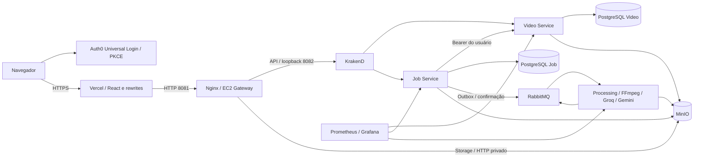

# Autenticação e deploy

## Ambiente publicado

Frontend: <https://video-insight-ruby.vercel.app>. A SPA React/Vite está na
Vercel; os três serviços, KrakenD, bancos, RabbitMQ e MinIO ficam na AWS.
As alternativas antigas EC2/CloudFront foram preservadas, mas não são usadas.



O Gateway encaminha `Authorization`; os dois serviços Java validam assinatura
RS256, expiração, emissor, audience e `sub`. Job → Video preserva o bearer.
O proprietário vem do JWT. Recursos de outro usuário retornam 404, inclusive
URLs de reprodução/exportação, exclusão, cancelamento e retry. Registros antigos
com dono `local-development` não foram transferidos. Processing é interno e
não recebe o token do usuário.

## Auth0

O tenant acessível é `dev-l73dre016gevtcsh.us.auth0.com`. Consulte o
[guia de login](login-auth0.md) para o Client ID público da SPA. A API tem
Identifier `https://video-insight-api` e RS256. A SPA tem **User-Delegated Access**
com autorização por aplicação. Não é necessário Client Secret ou grant M2M.

Mantenha `https://video-insight-ruby.vercel.app` e `http://localhost:5173` nas
três listas: **Allowed Callback URLs**, **Allowed Logout URLs** e
**Allowed Web Origins**. A conexão `Username-Password-Authentication` está
habilitada e é solicitada explicitamente pelo frontend. Tokens ficam na memória.

## HTTPS e assinatura S3

O [template Vercel](../apps/frontend/vercel.json.template) encaminha `/api/v1/*` ao Gateway
e `/storage/videos/*` e `/storage/artifacts/*` ao Nginx da mesma máquina.
O fallback da SPA não captura essas rotas nem assets. Respostas privadas usam
`Cache-Control: private, no-store`.

O storage assina URLs com o secret `STORAGE_PUBLIC_ENDPOINT`. O frontend troca a origem,
acrescenta `/storage` e preserva caminho e query original.
[`proxy.conf`](../infrastructure/aws/edge/proxy.conf.template) remove esse prefixo, fixa
`Host` com a porta original e encaminha os bytes ao MinIO privado. O rewrite
anterior direto ao MinIO causava `SignatureDoesNotMatch` por alterar o Host.
O proxy preserva `Content-Type`, parâmetros `X-Amz-*` e `Range`, transmite sem
buffer de corpo e aceita 110 MB para atender ao limite de produto de 100 MiB.
URLs assinadas são permissões temporárias; os logs do Nginx omitem sua query.

**Trecho sem TLS:** Vercel → Nginx público e os hops internos AWS usam HTTP.
O navegador usa HTTPS, sem mixed content, mas bearer e arquivos ficam sem TLS
no trecho de origem. TLS completo exige domínio/certificado na origem e acesso
à configuração de rede da disciplina. Os buckets continuam privados.

## GitHub e Vercel

Mantenha os secrets existentes: `AWS_SSH_PRIVATE_KEY`, `AWS_KNOWN_HOSTS`,
`VIDEO_DB_PASSWORD`, `JOB_DB_PASSWORD`, `RABBITMQ_PASSWORD`,
`MINIO_ROOT_PASSWORD`, `GRAFANA_ADMIN_PASSWORD`, `GROQ_API_KEY` e `GEMINI_API_KEY`.
O frontend também exige **`VERCEL_TOKEN`**, cadastrado em **Settings → Secrets
and variables → Actions**. A credencial da entrega já foi criada com autorização
do titular, limitada ao projeto `video-insight` e com validade de 30 dias.
O token anterior foi revogado. Renove essa credencial antes de expirar; não
envie seu valor no chat nem copie credenciais pessoais do CLI para o repositório.

| Variable GitHub | Valor |
| --- | --- |
| `AUTH_ISSUER` | `https://dev-l73dre016gevtcsh.us.auth0.com/` |
| `AUTH_AUDIENCE` | `https://video-insight-api` |
| `AUTH0_CLIENT_ID` | Client ID público da SPA do guia de login |
| `FRONTEND_ORIGIN` | `https://video-insight-ruby.vercel.app` |
| `API_PUBLIC_BASE_URL` | `https://video-insight-ruby.vercel.app/api/v1` |
| `VERCEL_ORG_ID` | ID da equipe Vercel |
| `VERCEL_PROJECT_ID` | ID do projeto `video-insight` |

Os hosts são **Secrets**, nunca Variables nem valores literais em arquivos:

| Secret | Uso |
| --- | --- |
| `AWS_GATEWAY_HOST`, `AWS_VIDEO_HOST`, `AWS_PROCESSING_HOST`, `AWS_CORE_HOST`, `AWS_OBSERVABILITY_HOST` | Acesso SSH às máquinas |
| `AWS_VIDEO_PRIVATE_HOST`, `AWS_JOB_PRIVATE_HOST`, `AWS_PROCESSING_PRIVATE_HOST`, `AWS_CORE_PRIVATE_HOST` | Rotas internas, storage e monitoramento |
| `AWS_DOCKER_BRIDGE_HOST`, `AWS_DOCKER_NETWORK_CIDR` | Bind dos túneis e regra de rede Docker |
| `STORAGE_PUBLIC_ENDPOINT` | Origem usada na assinatura S3 |
| `METRICS_ALLOWED_NETWORKS` | CIDRs autorizados a coletar métricas, separados por vírgula |

`scripts/render_deployment.py` gera Gateway, Vercel, Nginx, Prometheus e unidades
systemd a partir dos arquivos `.template`. Os arquivos gerados são ignorados
pelo Git. Sem secrets completos, a geração falha antes de gravá-los. Nunca use
`--example` no deploy: esse modo utiliza hosts locais somente para validar.

```bash
# Validação local sem acesso à infraestrutura:
python scripts/render_deployment.py gateway edge frontend observability tunnels --example

# No runner, os mesmos parâmetros vêm dos Secrets, sem --example:
python scripts/render_deployment.py gateway edge frontend observability tunnels
```

O CI também executa `scripts/check_sensitive_addresses.py`. Somente loopback,
bind genérico e faixas reservadas para exemplos de teste podem ser literais.
Os nomes `*.internal` dos diagramas são rótulos ilustrativos, não endereços reais.
IPs que já estavam em commits anteriores continuam no histórico antigo; esta
alteração remove os valores do estado atual e evita sua reintrodução.

No ambiente **Production** da Vercel:

```dotenv
VITE_API_BASE_URL=/api/v1
VITE_AUTH0_DOMAIN=dev-l73dre016gevtcsh.us.auth0.com
VITE_AUTH0_CLIENT_ID=CLIENT_ID_PUBLICO_DA_SPA
VITE_AUTH0_AUDIENCE=https://video-insight-api
VITE_STORAGE_PROXY_PATH=/storage
VITE_USE_MOCKS=false
```

Após os gates, o workflow usa `vercel@65.9.0 deploy --prod --yes` e o build remoto
carrega as variáveis Production. O CLI antigo não conseguia executar `pull` com
token restrito ao projeto; não foi ampliado o acesso à equipe para contornar
isso. Variáveis Vite vêm da Vercel, não das variables do GitHub. Alterá-las exige
novo build. Senhas, PEM e chaves de IA nunca podem ter prefixo `VITE_`.

## Pipeline e rollback

`deploy-aws.yml` chama `validate-repository.yml` com `full-validation: true`.
Contratos, Markdown, links, scanner, frontend e testes dos três serviços com
cobertura mínima de 80% bloqueiam o preflight e a implantação. Java usa
PostgreSQL real no CI. Processing testa RabbitMQ/MinIO reais e FFmpeg.
O Gitleaks mantém as regras padrão, com exceção específica para o Client ID
público documentado, sem desabilitar o detector de chaves genéricas.

As imagens AWS são compiladas no runner, enviadas por SSH e publicadas por
[`deploy-service.sh`](../infrastructure/aws/deploy-service.sh). O contêiner
anterior fica disponível para rollback. O script verifica health, autenticação,
conexão do consumidor e estabilidade. Os volumes são preservados. Java usa
512 MiB; com 320 MiB o Job sofria OOM após startup. KrakenD escuta apenas em
`127.0.0.1:8082`; Nginx publica a porta 8081.

Para comprovar o novo pipeline remoto, os arquivos precisam estar na branch
remota e o `VERCEL_TOKEN` deve existir. Deploy manual validado não equivale a um
pipeline remoto verde. O merge deve ocorrer após os checks do PR; a atualização da main dispara o deploy.

## Monitoramento

Prometheus coleta `/actuator/prometheus` em Video/Job e `/metrics` no Processing
a cada 15 segundos. As métricas aceitam somente VPC, ponte Docker e loopback;
não são expostas pelo Gateway. O dashboard **Video Insight: operação**, UID
`video-insight`, mostra disponibilidade, requisições, latência média, 5xx,
memória JVM e conexão do worker. O datasource existente é preservado.

Prometheus escuta no IP privado de Leonardo. Acesse Grafana por túnel SSH se a
porta 3000 não estiver liberada, usando a senha administrativa existente.
Volumes preservam histórico e painéis. Alertas e métricas de cada etapa da IA
não foram incluídos neste escopo.

Siga o [roteiro da entrega 4](entrega-4.md), o
[desenvolvimento local](desenvolvimento-local.md) e os
[testes ponta a ponta](../tests/end-to-end/README.md).
