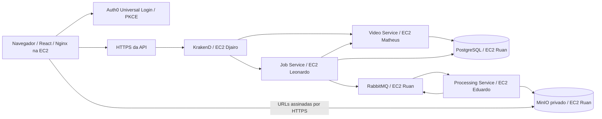

# Autenticação e deploy

## Arquitetura

O Video Service cadastra metadados, valida o upload e emite URLs temporárias.
O navegador envia o arquivo diretamente ao MinIO. O Job Service verifica o
vídeo e grava o pedido de processamento e o evento no outbox na mesma transação.
O worker Python consome RabbitMQ, extrai áudio com FFmpeg e usa Groq/Gemini para
produzir os resultados. Eventos atualizam o Job Service, consultado por polling
pelo frontend. Os bancos são separados por serviço. Túneis SSH existentes
conectam os serviços às dependências; Prometheus e Grafana ficam na EC2 Leonardo.

O gateway encaminha o header `Authorization`. Video Service e Job Service
validam o JWT independentemente: assinatura RS256, expiração, emissor, audience
e subject. A consulta interna Job → Video preserva o mesmo bearer token.
Nenhum header de identidade enviado pelo cliente determina o proprietário.
O Processing Service continua sendo um consumidor interno, sem login de usuário.

Vídeos e jobs recebem `owner_id` a partir do `sub` validado. Listas, paginação,
URLs, cancelamentos, tentativas e resultados são restritos ao dono. Outro usuário
recebe 404. A chave de idempotência é única por usuário. Registros anteriores
ficam associados a `local-development`; não são atribuídos automaticamente ao
primeiro usuário que entrar. Uma eventual migração desses registros exige uma
associação explícita com o `sub` escolhido.

## 1. Criar o Auth0

1. Crie sua conta e seu tenant no [Auth0](https://auth0.com/pt).
2. Abra **Applications → Applications → Create Application**.
3. Nome: `Video Insight Frontend`. Tipo: **Single Page Web Applications**.
4. Em **Settings**, copie **Domain** e **Client ID**.
5. Em **Allowed Callback URLs**, **Allowed Logout URLs** e
   **Allowed Web Origins**, cadastre `http://localhost:5173`.
6. Quando tiver a URL HTTPS definitiva do frontend, acrescente essa origem HTTPS nos
   três campos, separada por vírgula. Exemplo: `https://DISTRIBUICAO-FRONTEND.cloudfront.net`.
   O callback usa a raiz da aplicação, sem `/login` ou `/callback`.
7. Salve. Garanta que a conexão de usuários esteja habilitada para essa SPA em
   **Connections**. Universal Login permite cadastro e entrada.
8. Abra **Applications → APIs → Create API**. Nome: `Video Insight API`.
   Identifier: `https://video-insight-api`. Signing Algorithm: **RS256**.

O Identifier é uma identificação lógica; não precisa resolver no DNS. Use o
mesmo valor como audience em todos os ambientes. Não é necessário Client Secret,
Management API, uma aplicação Machine to Machine ou Auth0 Actions para esse fluxo.
O SDK gerencia Authorization Code com PKCE e guarda tokens em memória.

Referência: [SDK oficial React](https://auth0.github.io/auth0-react/).

## 2. Preparar HTTPS na AWS

O frontend usa Nginx em uma EC2. SPA, API e URLs assinadas do MinIO
precisam de HTTPS; caso contrário, o navegador bloqueia as chamadas como mixed
content. Publicar apenas o frontend não resolve isso.

O arquivo [`cloudfront.yaml`](../infrastructure/aws/edge/cloudfront.yaml) prepara
três distribuições sem domínio próprio: frontend Nginx, KrakenD e MinIO.
Na AWS, abra **CloudFormation → Create stack → With new resources**, envie esse
arquivo e informe os DNS públicos das EC2 do frontend, gateway e Core, sem
protocolo ou porta. `FrontendPort` deve ser igual a `AWS_FRONTEND_PORT` (8081 por
padrão). A conta precisa permitir criar distribuições CloudFront. A criação
pode gerar cobrança conforme o uso; confira os preços da sua conta antes de
criar a stack. Não foi criada nenhuma distribuição automaticamente.

Depois da criação, copie os outputs `FrontendOrigin`, `ApiBaseUrl` e `StoragePublicEndpoint`.
O template desativa cache, inclusive de erros 403/404, e encaminha todos os
headers e query strings. Preservar `Host` e os parâmetros `X-Amz-*` é necessário
para o MinIO validar as URLs assinadas. Não acrescente um prefixo ao endpoint
de storage e não altere a URL assinada no frontend.

**Limitação da infraestrutura da disciplina:** esse template usa HTTP na porta
8081 entre CloudFront e EC2, compatível com a restrição de rede atual. O navegador
usa HTTPS, mas esse trecho até a origem permanece sem TLS. Para uma implantação
com TLS em todo o caminho, configure certificado na origem (por exemplo, ALB ou
proxy com domínio/certificado) e troque a política para `https-only`. Restrinja
as origens aos endereços de origem do CloudFront e os serviços Java à rede
interna assim que o administrador permitir alterar o Security Group.

Referência: [headers encaminhados pelo CloudFront](https://docs.aws.amazon.com/AmazonCloudFront/latest/DeveloperGuide/RequestAndResponseBehaviorCustomOrigin.html).

## 3. Configurar o GitHub

Abra **Settings → Secrets and variables → Actions** no repositório. Há duas
abas diferentes: **Secrets** guarda as chaves e senhas; **Variables** guarda os
hosts e as configurações públicas. A Action usa repository-level variables.

### Secrets

Mantenha os secrets existentes. O frontend reutiliza `AWS_SSH_PRIVATE_KEY` e
`AWS_KNOWN_HOSTS`; não requer secret Auth0 nem credenciais de API da AWS.

| Secret | Conteúdo |
| --- | --- |
| `AWS_SSH_PRIVATE_KEY` | Conteúdo completo da chave privada PEM autorizada nas EC2 |
| `AWS_KNOWN_HOSTS` | Linhas OpenSSH dos hosts de destino, incluindo o frontend, com fingerprints conferidos |
| `VIDEO_DB_PASSWORD` | Senha PostgreSQL do Video Service |
| `JOB_DB_PASSWORD` | Senha PostgreSQL do Job Service |
| `RABBITMQ_PASSWORD` | Senha do usuário RabbitMQ |
| `MINIO_ROOT_PASSWORD` | Senha MinIO usada pelos serviços |
| `GRAFANA_ADMIN_PASSWORD` | Senha administrativa Grafana |
| `GROQ_API_KEY` | Chave do provedor de transcrição |
| `GEMINI_API_KEY` | Chave do provedor de geração |

`AWS_KNOWN_HOSTS` não é uma chave privada: são as entradas de chave pública do
servidor no formato `hostname algoritmo chave`. Se for usada uma nova EC2,
acrescente seu IP/DNS exatamente como aparece em `AWS_FRONTEND_HOST`. Confira
os fingerprints pelo acesso confiável à máquina antes de cadastrar as entradas.
Nunca envie PEM ou senhas pelo chat.

### Variables

| Variable | Valor |
| --- | --- |
| `AUTH_ISSUER` | `https://dev-wj6kifnw5uxt2gpk.us.auth0.com/` |
| `AUTH0_CLIENT_ID` | `ni2qNMV1N9PYkxUOqUNaIC5vbgF28BsJ` (SPA) |
| `AUTH_AUDIENCE` | **Identifier** cadastrado em Applications → APIs → sua API → Settings |
| `AWS_FRONTEND_HOST` | IP ou DNS público da EC2 do frontend, sem protocolo ou porta |
| `AWS_FRONTEND_PORT` | `8081` por padrão; use uma porta livre se compartilhar a EC2 |
| `FRONTEND_ORIGIN` | Output `FrontendOrigin`, sem `/` final |
| `API_PUBLIC_BASE_URL` | Output `ApiBaseUrl`, incluindo `/api/v1` |
| `STORAGE_PUBLIC_ENDPOINT` | Output `StoragePublicEndpoint`, sem `/` final |
| `AWS_GATEWAY_HOST` | Host público existente de Djairo |
| `AWS_VIDEO_HOST` | Host público existente de Matheus |
| `AWS_PROCESSING_HOST` | Host público existente de Eduardo |
| `AWS_CORE_HOST` | Host público existente de Ruan |
| `AWS_OBSERVABILITY_HOST` | Host público existente de Leonardo |

Se o Identifier escolhido foi `https://video-insight-api`, esse é o valor de
`AUTH_AUDIENCE`. O Client ID `83YzuvHXSbj0CNYbWZrwrFcP5IkZO995` informado para
a API não substitui o Identifier e não é usado neste fluxo. O Client Secret
não deve ser cadastrado: esta aplicação usa uma SPA pública com PKCE.

O workflow deriva `VITE_AUTH0_DOMAIN` do `AUTH_ISSUER`, usa `AUTH0_CLIENT_ID`
para `VITE_AUTH0_CLIENT_ID`, `AUTH_AUDIENCE` para `VITE_AUTH0_AUDIENCE` e
`API_PUBLIC_BASE_URL` para `VITE_API_BASE_URL`. Esses valores ficam no JavaScript
público após o build. Não é necessário criar essas `VITE_*` separadamente no
GitHub. Mudanças nas variables exigem novo build/deploy.

## 4. Publicar a SPA na EC2

1. Prepare uma EC2 Ubuntu com Docker, `curl`, UFW e acesso SSH do usuário
   `ubuntu` com permissão para executar Docker por `sudo` sem senha, como as
   máquinas atuais. O workflow não cria a EC2 nem instala Docker.
2. Autorize nela a mesma chave pública correspondente a `AWS_SSH_PRIVATE_KEY`.
   Atualize `AWS_KNOWN_HOSTS` e `AWS_FRONTEND_HOST` no GitHub.
3. Escolha a porta. Em uma máquina própria, use `8081`. Se compartilhar uma EC2
   cujo serviço já usa 8081, escolha outra porta livre e use o mesmo número em
   `AWS_FRONTEND_PORT` e `FrontendPort` da stack CloudFormation. Não reutilize
   uma porta ocupada. O administrador precisa permitir a porta no Security Group;
   o workflow só abre a porta no UFW da máquina. A restrição atual da disciplina
   permite 8081, portanto uma porta diferente exige liberação adicional.
4. Crie ou atualize a stack HTTPS do passo 2. Configure os outputs nas Variables.
   Se já houver HTTPS por um proxy/ALB, use suas URLs equivalentes.
5. No Auth0, adicione o `FRONTEND_ORIGIN` nas três listas da SPA: **Allowed
   Callback URLs**, **Allowed Logout URLs** e **Allowed Web Origins**.
6. Depois que as alterações estiverem na `main`, abra **Actions → Deploy to AWS
   → Run workflow**. Essa execução manual refaz o deploy de todos os componentes
   e aplica CORS e autenticação. Nos pushes seguintes, o filtro atualiza apenas
   os componentes alterados. Alterações em frontend ou no script de deploy
   disparam o job `deploy-frontend`.

A Action executa `npm ci`, lint, testes e build Vite em Node 22; empacota `dist/`
num contêiner Nginx, transfere a imagem por SSH e executa
[`frontend/deploy.sh`](../infrastructure/aws/frontend/deploy.sh). A EC2 não
precisa de Node. O servidor atende `/login`, `/videos` e outras rotas React pelo
fallback para `index.html`, mas assets ausentes retornam 404. O HTML não recebe
cache, evitando referenciar chunks antigos depois de um deploy.

O script verifica a imagem em uma porta temporária local antes de trocar o
contêiner público. Depois verifica health, HTML e rotas internas; se a nova
versão falhar, restaura o contêiner anterior. A troca tem uma breve interrupção.
Se uma execução for encerrada abruptamente e deixar um contêiner com sufixo
`-previous`, confira-o na EC2 antes de executar novamente. As imagens antigas
não são removidas automaticamente; acompanhe o espaço em disco.

O build de produção exige autenticação, API HTTPS e mocks desativados. Os dois
serviços Java recebem `AUTH_ENABLED=true`; o gateway e MinIO recebem a origem
CORS pública do frontend. O workflow espera os componentes de dados antes de
atualizar serviços dependentes e verifica resposta 401 sem token no gateway.

Referência: [build estático do Vite](https://vite.dev/guide/static-deploy.html).

## 5. Teste de aceite em produção

1. Abra a URL do frontend sem sessão: deve exibir o login.
2. Cadastre uma conta, entre e confira a volta para `/videos`.
3. Envie um MP4 pequeno e acompanhe upload, processamento e resultado.
4. Confirme que vídeo, transcrição e artefatos usam URLs HTTPS assinadas.
5. Saia e entre com uma segunda conta: a lista deve estar vazia. Tentar abrir
   os IDs da primeira conta deve retornar 404, inclusive resultados e URLs.
6. Chame uma rota de negócio sem token: deve retornar 401. Health permanece
   disponível para os checks de infraestrutura.
7. Recarregue uma rota interna no Nginx e confirme que a sessão é restabelecida
   ou o login é solicitado. O frontend não mantém tokens em localStorage.

## Desenvolvimento local

Copie `apps/frontend/.env.example` para `.env.local` e preencha os três valores
Auth0. Para os serviços Java, defina `AUTH_ENABLED=true`, `AUTH_ISSUER` e
`AUTH_AUDIENCE` no processo ou contêiner. `npm run dev:local` usa o proxy Vite
para os serviços em `8081` e `8082`, preservando Authorization.

Sem Auth0 configurado, a SPA bloqueia as rotas protegidas e informa a
configuração ausente no login, inclusive em desenvolvimento. Os serviços Java
precisam de `AUTH_ENABLED=true` para exigir tokens, também no ambiente local.
