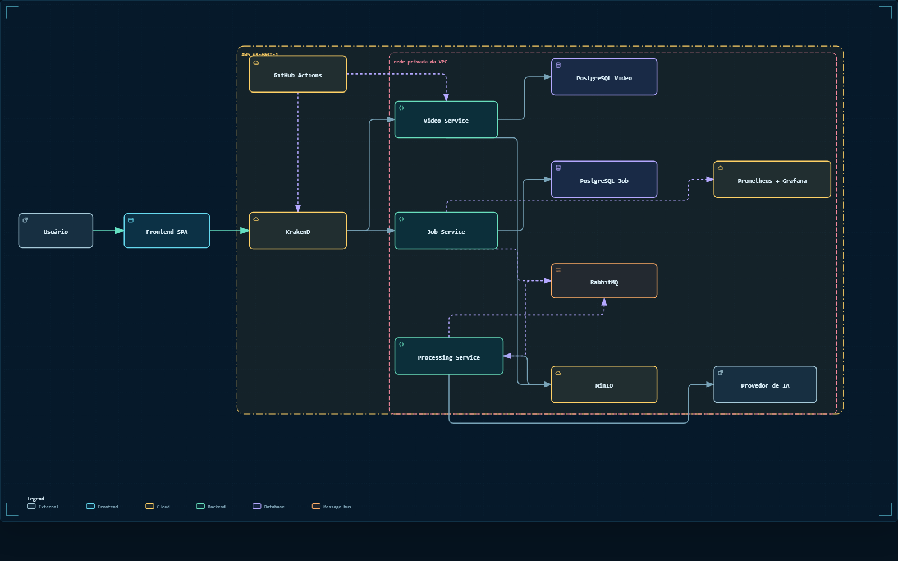

# Primeira entrega: definição, arquitetura e deploy

## Ideia do projeto

O Video Insight transforma vídeos informativos em conteúdo pesquisável. O
usuário envia um MP4 e recebe transcrição com timestamps, resumo e capítulos
automáticos. O processamento ocorre em segundo plano para que uploads e tarefas
longas não bloqueiem a interface.

O MVP está limitado a vídeos de até 10 minutos e 100 MB. Streaming, edição
completa, tradução, dublagem e treinamento de modelos ficam fora desta etapa.

## Serviços

| Serviço | Responsabilidade | Tecnologia | Deploy |
|---|---|---|---|
| Video Service | Metadados, propriedade e acesso ao arquivo | Java 21 e Spring Boot | EC2 de Matheus Pereira |
| Job Service | Estado, progresso, tentativas e resultados dos jobs | Java 21 e Spring Boot | EC2 de Marcus |
| Processing Service | FFmpeg, transcrição, resumo e capítulos | Python 3.12 e FastAPI | EC2 de Eduardo Marcelino |

O KrakenD, na máquina de Djairo, é o ponto único de entrada HTTP. Os três
serviços expõem `GET /health` nesta entrega para comprovar build, deploy e
comunicação. As APIs de negócio já estão definidas em OpenAPI, mas serão
implementadas nas próximas entregas.

## Arquitetura

[Abrir diagrama interativo da arquitetura AWS](arquiteturas/videos-ia-aws.html)

O fluxo planejado é:

1. O frontend chama o KrakenD.
2. O Gateway encaminha vídeos ao Video Service e jobs ao Job Service.
3. Video Service mantém seu PostgreSQL e usa o MinIO para vídeos e artefatos.
4. Job Service mantém outro PostgreSQL e publica `processing.requested` no
   RabbitMQ.
5. Processing Service consome a solicitação, usa MinIO e um adapter de IA e
   publica eventos de progresso, conclusão ou falha.
6. Prometheus coleta inicialmente suas próprias métricas e o Grafana recebe a
   fonte de dados pronta; a instrumentação dos serviços evolui com a aplicação.

O Processing Service não acessa PostgreSQL. Ele se integra a RabbitMQ, MinIO e
ao provedor de IA; o Job Service persiste o estado comunicado pelos eventos.

## Distribuição nas máquinas AWS

| Máquina | Componente | Porta do produto |
|---|---|---|
| Djairo | KrakenD | `80` |
| Matheus Pereira | Video Service | `8081` |
| Marcus | Job Service | `8081` |
| Eduardo Marcelino | Processing Service | `8081` |
| Ruan | Dois PostgreSQL, RabbitMQ e MinIO | `5433`, `5434`, `5672`, `9000` |
| Leonardo Moretti | Prometheus e Grafana | `9090`, `3000` |

As comunicações internas usam os endereços privados da VPC. Senhas e a chave
SSH são secrets do GitHub e não ficam no repositório.

Para acesso pela internet, o Security Group da máquina de Djairo precisa
permitir TCP `80`. Essa regra depende de uma identidade AWS com permissão para
alterar grupos de segurança.

## Deploy automático

O workflow [`.github/workflows/deploy-aws.yml`](../.github/workflows/deploy-aws.yml)
roda em pushes para `main`. Filtros de caminho identificam o componente
alterado, constroem e testam sua imagem, copiam a imagem por SSH, substituem
somente o contêiner do Video Insight e confirmam o endpoint de saúde.

O ambiente compartilhado e a observabilidade também têm deploy seletivo quando
seus respectivos diretórios mudam. O workflow de validação continua verificando
Markdown, links, contratos, Docker Compose, imagens dos serviços e secrets.

## Evidências de conclusão

- Monorepo privado publicado em `djairofilho/video-insight`.
- Estrutura dos três serviços criada e executável.
- Contratos OpenAPI e JSON Schema versionados.
- Ambientes local e AWS descritos como código.
- Diagrama AWS validado deterministicamente e revisado visualmente.
- CI e CD configurados com filtros por diretório.

Os links das execuções de CI/CD e o estado final das instâncias devem ser
consultados na página de Actions do repositório, que mantém o histórico de cada
deploy.
